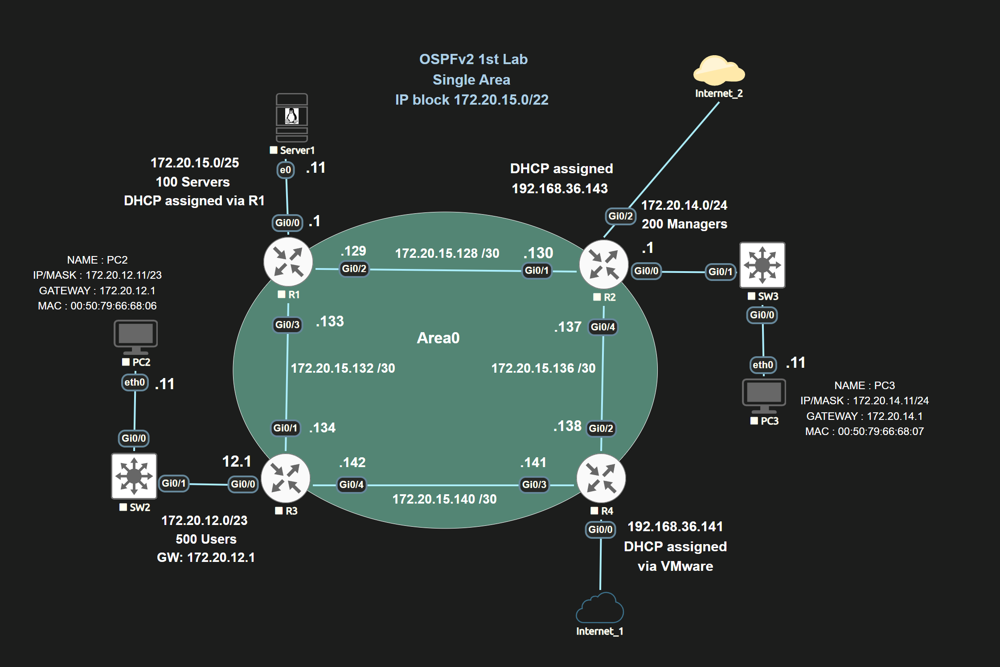

# Lab: OSPFv2 Single-Area Core Topology Validation

## 🎯 Architecture Overview & Verification Blueprint
Validate single-area Open Shortest Path First (OSPFv2) deployment across a 4-router loop network linked directly via `/30` point-to-point transit networks. 

---

## 🛠️ Modern Interface Configuration Strategy
*💡 **Engineering Shift:** Avoid legacy, sloppy `network [net] [wildcard] area 0` lines inside the root router engine loop. Instead, bind OSPF configuration hooks directly onto the specific network interfaces to eliminate wildcard math errors entirely:*

```cisco
R2(config)# interface GigabitEthernet0/1
R2(config-if)# ip ospf 1 area 0
!
R2(config)# interface GigabitEthernet0/4
R2(config-if)# ip ospf 1 area 0
```

---

## 🔍 Forensic Verification Logs (Live Shell Captures)

### 1. Active Adjacency Verification (`show ip ospf neighbor`)
Ensure that neighbor status tracking matrices successfully lock in at the stable **`FULL`** state:
```text
R1#show ip ospf neighbor
Neighbor ID     Pri   State           Dead Time   Address         Interface
3.3.3.3           1   FULL/BDR        00:00:34    172.20.15.134   GigabitEthernet0/3
2.2.2.2           1   FULL/BDR        00:00:32    172.20.15.130   GigabitEthernet0/2
```

### 2. Primary Routing Information Base Inspection (`show ip route`)
Verify that Equal-Cost Multi-Pathing (ECMP) routing and default gateways are cleanly populated:
```text
R1#show ip route
Gateway of last resort is 172.20.15.134 to network 0.0.0.0

O*E2  0.0.0.0/0 [110/1] via 172.20.15.134, 00:39:33, GigabitEthernet0/3
                [110/1] via 172.20.15.130, 00:39:33, GigabitEthernet0/2
      172.20.0.0/16 is variably subnetted, 10 subnets, 5 masks
O        172.20.12.0/23 [110/2] via 172.20.15.134, 00:25:41, GigabitEthernet0/3
O        172.20.14.0/24 [110/2] via 172.20.15.130, 00:27:14, GigabitEthernet0/2
C        172.20.15.0/25 is directly connected, GigabitEthernet0/0
C        172.20.15.128/30 is directly connected, GigabitEthernet0/2
```

### 3. Link-State Database Auditing (`show ip ospf database`)
```text
R1#show ip ospf database
            OSPF Router with ID (172.20.15.133) (Process ID 1)

                Router Link States (Area 0)
Link ID         ADV Router      Age         Seq#       Checksum Link count
2.2.2.2         2.2.2.2         863         0x8000000B 0x00D7E1 4
3.3.3.3         3.3.3.3         755         0x8000000B 0x005549 4
4.4.4.4         4.4.4.4         724         0x80000009 0x003B2D 3

                Type-5 AS External Link States
Link ID         ADV Router      Age         Seq#       Checksum Tag
0.0.0.0         4.4.4.4         498         0x80000003 0x00F4A8 4
```

---

## 📊 Data Plane Verification (Ping Matrices)
```text
R1#ping 172.20.14.11 (Manager Network Endpoint) -> !!!!! (100% Success Rate)
R1#ping 172.20.12.11 (User Network Endpoint)    -> !!!!! (100% Success Rate)
```
